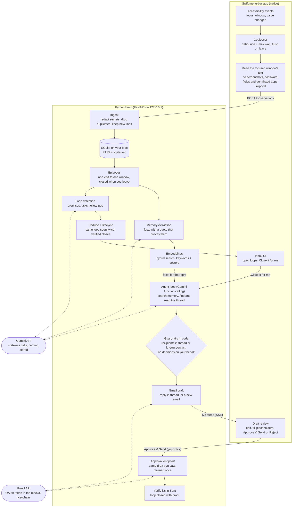

# macOS Context Agent

### Remember your work. Then get it done.

A local-first Mac assistant that reads what's on your screen through the **Accessibility API** (text only, no screenshots), remembers it, finds your **open loops** (promises, follow-ups, unanswered asks), and then **closes them for you**: it drafts the email, you approve it, it sends, and it checks that the email actually went out.

Inspired by [Minimi](https://www.projectminimi.com/), which captures context, builds memory and shows an *Open loops* inbox. **The addition here is the action agent:** finding a loop is half the job; this does the other half, with a human approving every outward action.

<!-- Demo video / GIF goes here -->

## What it does

1. **You promise something, anywhere.** You reply to an email, *"I'll send you the repo link by Thursday"*, or say it on WhatsApp.
2. **It becomes a loop.** When you leave that window, the text you saw is checked for commitments. The loop shows up in the menu-bar inbox with the source app, the deadline, and the exact quote that created it.
3. **"Close it for me."** The agent searches your memories and Gmail, reads the thread and drafts a reply. If the promise wasn't made in email, it drafts a new email instead. Anything it can't know (a link, a decision only you can make) is left as a `[[placeholder]]`, and Send stays disabled until you fill it in.
4. **You approve, it sends, it verifies.** The draft is sent only after you click, and only if it's exactly the draft you reviewed. The loop closes once Gmail shows the email in Sent, with a link to it as proof.

## How it works



- **Nothing is sent without your click.** The agent has no send tool. Only the approval endpoint sends, and only the exact draft you reviewed.
- **Screen text is data, not instructions.** It's delimited in every prompt, and the recipient and authority rules are enforced in code, not left to the model.
- **One file holds everything:** `~/Library/Application Support/ContextAgent/brain.db`. Pause capture at any time, and delete everything from Settings.

## Evals: how I know it works

Every AI step is measured against hand-labelled test sets with a real model, not just demoed. The full method and results are in **[docs/eval-report.md](docs/eval-report.md)**.

| What's measured | Test set | Result (`gemini-3.5-flash-lite`) |
|---|---|---|
| **Retrieval:** does search find the right memory? | 31 questions over 45 memories | Recall@5 **97%** (hybrid), MRR **0.94** |
| **Loop detection:** does it find real promises and ignore noise? | 43 labelled screens + 16 held out | Precision **100% / 91%**, recall **100% / 100%**, **0 unsafe closes** |
| **Agent:** does "Close it for me" do the right thing, safely? | 12 scenarios incl. prompt injection | **12/12**, **0 emails sent** by the agent, every draft judged 5/5 |

The most useful finding: the first agent eval passed 10/10 while one draft agreed to renew an 11-month lease on the user's behalf. The rubric had no "authority" axis, so nothing caught it. Fixing the eval first, then moving the rule from the prompt into code, is the story in the report.

## Run it

**You need:** an Apple Silicon Mac on macOS 14+, Xcode 16+ (for the Swift 6 toolchain), [uv](https://docs.astral.sh/uv/) (`brew install uv`), and a free [Gemini API key](https://aistudio.google.com/apikey). Python 3.13 is installed by uv automatically.

```bash
git clone <this repo> && cd mac-cuck
cp .env.example .env          # add GEMINI_API_KEY, your name and email
cd brain && uv sync && cd ..  # exact locked dependencies (uv.lock)
```

Then, in two terminals:

```bash
make brain      # terminal 1: the brain on 127.0.0.1:8765. Leave it running.
make run-app    # terminal 2: builds, signs and opens the menu-bar app (the eye icon)
```

The first time, macOS asks for **Accessibility** access: System Settings → Privacy & Security → Accessibility → turn on Context Agent. That's all it needs. There is no screen-recording permission.

**Try it:** open an email or chat where you promise something with a deadline, switch to another window, and the loop appears in the panel within a few seconds.

### Connect Gmail (optional, for "Close it for me")

Without Gmail, everything except the agent works: capture, memories and open loops. To let the agent draft and send:

1. In [Google Cloud Console](https://console.cloud.google.com/), create a project and enable the **Gmail API**.
2. Under **OAuth consent screen**, choose *External*, keep it in *Testing*, and add your Gmail address as a test user.
3. Under **Credentials**, create an **OAuth client ID** of type *Desktop app*, download it, and save it as `credentials.json` in the repo root (it's gitignored).
4. Run `cd brain && uv run brain gmail-login` and approve in the browser. The token is stored in your macOS **Keychain**, not in a file.

The agent asks only for `gmail.readonly` + `gmail.compose`. Compose technically includes sending, which is why sending is gated in the code's architecture (no send tool, approval of the exact draft), not just by a permission.

### Good to know

- **The brain reads `.env` only at startup.** After changing it, restart with Ctrl-C and `make brain`.
- **The app reconnects by itself.** You can start the two in either order. If the brain isn't running, the panel says so.
- **Pause and exclusions:** the panel's toggle pauses capture. Settings lets you never capture an app. Password managers, banking and System Settings are never read, and nor is any password field.
- **Without an Apple Development certificate,** the app is signed ad-hoc and macOS forgets the Accessibility grant on every rebuild. Run `make reset-permission` and grant it again.
- **Free-tier note:** on Gemini's free tier, Google may use the text you send to improve its models. A paid key changes that. Pause capture whenever you don't want the screen read.
- **Tests:** `make test` runs everything offline (pytest + swift test). Evals call the real model: see the [eval report](docs/eval-report.md).

## Tech stack

| Layer | Choice |
|---|---|
| App | Swift 6, SwiftUI `MenuBarExtra`, macOS Accessibility API (`AXUIElement`, `AXObserver`) |
| Brain | Python 3.13, uv, FastAPI, Pydantic v2, pytest |
| Models | Gemini (`gemini-3.5-flash-lite` / `gemini-3.8-flash`) through `google-genai`, stateless calls, structured outputs, hand-written function-calling loop |
| Memory | SQLite (WAL) + FTS5 + `sqlite-vec`, `gemini-embedding-2` at 768 dimensions, hybrid search with rank fusion |
| Action | Gmail API, OAuth installed-app flow, token in the macOS Keychain |

## Repo map

- `app/`: the Swift menu-bar app (capture, inbox, draft review).
- `brain/`: the Python service (ingest, memory, loops, agent, mailbox), plus `tests/` and `evals/`.
- `docs/`: [eval report](docs/eval-report.md), [demo script](docs/demo-script.md), [capture coverage](docs/capture-coverage.md), [Minimi teardown](docs/minimi-teardown.md).
- [decisions.md](decisions.md) (every technical decision, with options and tradeoffs), [challenges.md](challenges.md) (the hard problems and how they were solved), [learnings.md](learnings.md) (concept notes).
